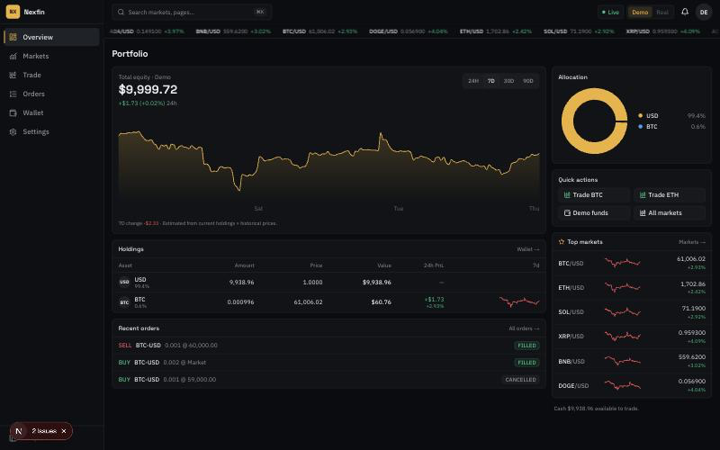
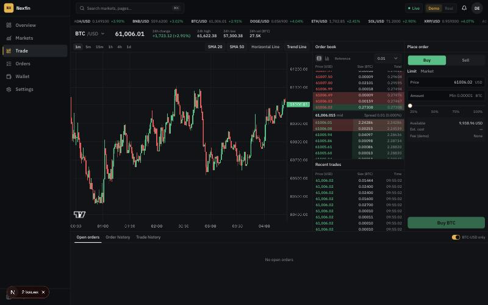
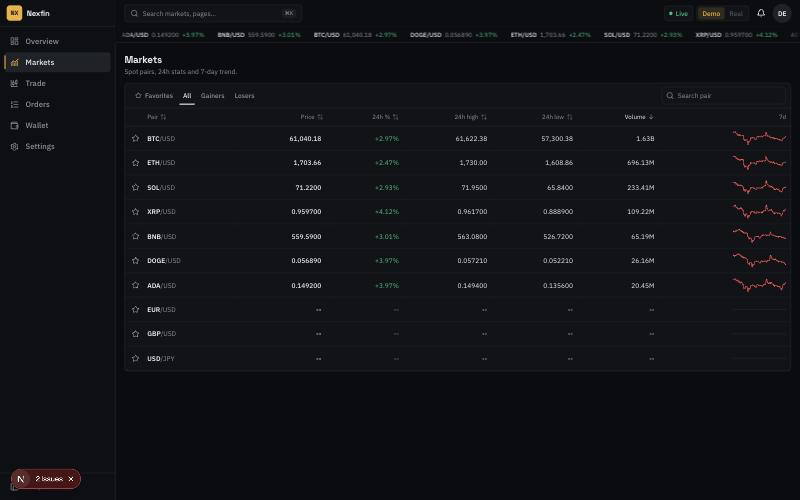
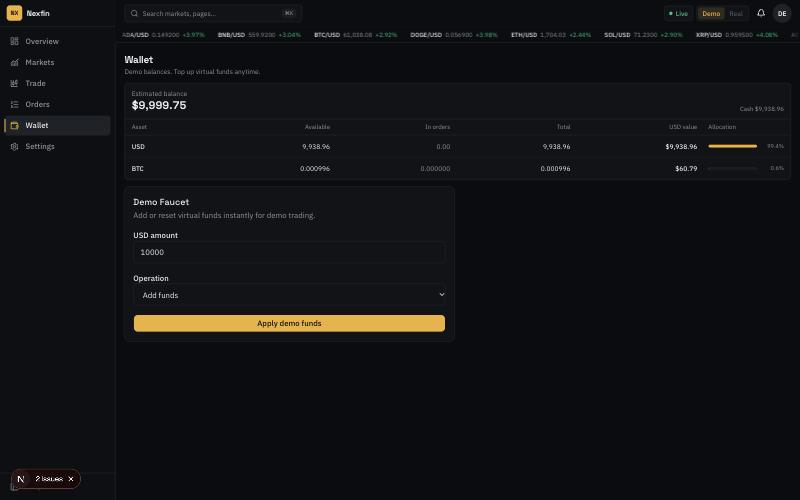
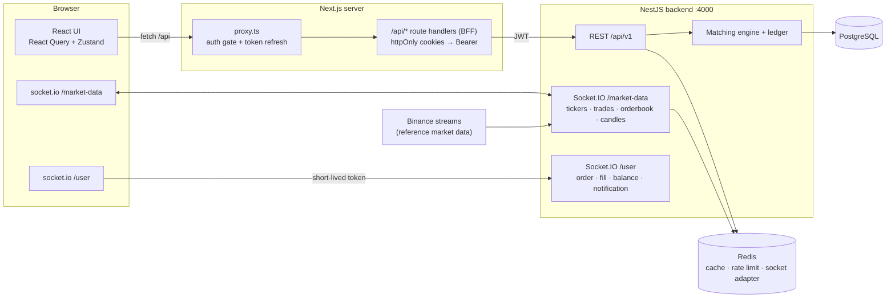

# Nexfin — Crypto Exchange Frontend

A dense, dark-first spot exchange UI built with **Next.js 16 (App Router)** and **React 19**, on top of the
NestJS exchange in [`../backend`](../backend). It has a pro trading terminal with live order book, trades and
chart, a portfolio dashboard, a markets screener, wallet flows, price alerts, notifications, API keys and an
admin console. Live data arrives over Socket.IO; REST goes through a small Next.js BFF that keeps tokens in
httpOnly cookies.

> Portfolio project. Demo balances are virtual, deposits are simulated, and nothing here moves real money.

## Screenshots

| | |
| --- | --- |
|  |  |
|  |  |

## Features

**Trading terminal** (`/trading/[symbol]`)
- Resizable desktop layout: chart · order book + trades · order ticket · bottom panel. On mobile it becomes Chart / Book / Trades / Trade tabs.
- Symbol bar with a searchable pair switcher, a flashing last price, and 24h change/high/low/volume.
- Order book with asks/spread/bids, cumulative depth bars, price grouping by tick, click-to-fill, a depth chart and row flashes. It shows the exchange engine book, or the upstream reference book (labelled) when the engine book is empty.
- Order ticket: Buy/Sell, Limit/Market, market buy by base or quote amount, a % slider of available balance, GTC/IOC/FOK and post-only (REAL accounts), a fee line from the account's maker/taker schedule, and a confirm dialog with "don't ask again".
- Optimistic open-order rows, status toasts with reasons (IOC remainder, post-only, insufficient liquidity, …), and live updates from the private stream.
- Bottom panel: open orders (cancel), order history, and trade history (fills, with fee and maker/taker).

**Markets** (`/markets`) has a sortable, searchable table with live prices (flash), 24h % / high / low / volume and a 7-day sparkline. There are Favorites / All / Gainers / Losers tabs, and favorites are saved per browser. A ticker tape scrolls in the app header.

**Portfolio** (`/dashboard`)
- Total equity with 24h change, and an equity chart with range tabs.
- Allocation donut, holdings with USD value and 24h PnL, recent fills and orders, a watchlist and quick actions.
- A fresh account gets an empty state with a demo-faucet or deposit CTA.

**Wallet** (`/wallet`)
- Balances with USD value and allocation.
- Demo deposit address (clearly labelled) with QR and copy, plus a simulated deposit.
- Withdrawals with network / fee preview, validation and a confirm dialog.
- History with status timelines.

**Settings** (`/settings`)
- Active sessions, with sign-out of other devices.
- API keys: scoped permissions and IP whitelist; the secret is shown once.
- Price alerts.
- 2FA is not implemented (the backend doesn't support it yet).

**Notifications**: the header bell has unread badges and mark-read. Live inserts come from the private stream (price alerts, fills, deposits, withdrawals).

**Admin** (`/admin`)
- KPI cards, user-growth and market-volume charts.
- Searchable and paginated users table.
- Withdrawal queue with approve and reject (with a reason).

**App shell**
- Collapsible icon sidebar; drawer plus bottom nav on mobile.
- ⌘K command palette for pages and markets.
- User menu with theme switch.
- Demo/Real mode toggle and a socket connection status pill.
- Error boundaries and 404 pages.

### Honest limitations

- **Derived data.** Equity history is estimated as *current holdings × historical candles*, because there are no equity snapshots yet. Dashboard PnL is the 24h mark-to-market change, because cost basis isn't tracked yet. Admin volume uses market candles, not exchange volume.
- **DEMO vs REAL.** DEMO accounts have no fills endpoint, fee schedule or private events. The UI falls back to filled orders and "Fee (demo): None".
- **Liquidity.** The REAL matching engine needs resting liquidity for market orders. Locally it is often empty, and the ticket tells you so.
- **Withdrawal networks and fees** are display estimates; the backend ledger is USD-only.

## Tech stack

| Area | Choice |
| --- | --- |
| Framework | Next.js 16 App Router (Turbopack), React 19, TypeScript, typed routes |
| UI | Tailwind CSS v4, shadcn/ui (Radix), lucide icons, self-hosted fonts (`@fontsource` via `next/font/local`) |
| Data | TanStack Query v5 (server state), Zustand (client and live-stream state) |
| Realtime | `socket.io-client`: `/market-data` (public) and `/user` (private) |
| Charts | lightweight-charts v5 (candles), Recharts via shadcn `chart` (equity, allocation, admin) |
| Money | `decimal.js` (same config as the backend), never JS floats for amounts that are validated or sent |
| Forms/validation | Zod, react-hook-form (auth) |
| Tests | Vitest + Testing Library, Playwright smoke |

## Architecture



### Data flow

- **REST via the BFF.** The browser only talks to `/api/*` on the Next.js origin. Route handlers read the access token from an httpOnly cookie and call the backend with `Authorization: Bearer`. They also forward the trading mode, client IP and user agent. Response shapes go through `modules/market/services/normalize.ts`, so components don't break when the API shape changes.
- **Refresh tokens.** Login stores the access cookie (it expires just before the JWT) and the refresh cookie. When the access cookie is gone, `src/proxy.ts` rotates the tokens before the request reaches a page or route. Refreshes are de-duplicated per token, because refresh tokens are single-use and pages fire parallel requests. Route handlers also refresh once on a 401. Logout revokes the backend session.
- **Live market data.** One shared `/market-data` socket is used, with ref-counted rooms that re-join after a reconnect. `tickers` feeds a ticker store used by the markets table, ticker tape, dashboard and symbol bar. `subscribe_symbol` streams the engine `orderbook`, `trades` batches and `ticker`; `live_orderbook` is the upstream reference book. Components select narrow slices of the store, and rows are memoised. Price and size flashes are DOM attributes with CSS animation, so updates don't trigger re-renders.
- **Private stream.** `/user` authenticates with a short-lived token from `/api/auth/socket-token`, fetched again on every reconnect. `order` events invalidate the order queries, `balance` events patch the portfolio cache in place, `fill` events toast (with the same toast id as the order, so there are no duplicates), and `notification` events insert into the bell.
- **Money.** The backend sends decimal strings. Ticket quantities, tick/step rounding, balance checks and withdrawal validation use `decimal.js` (`src/lib/utils/decimal.ts`). Plain numbers are only used for charts and approximate displays.
- **Rate limits.** Polling is minimal, since the sockets carry the live data. 429 responses are retried with backoff, and other 4xx responses are never retried.

## Project structure

```text
src/
  app/                    App Router: pages, error/not-found boundaries, /api BFF routes
    (public)/             login, register
    (dashboard)/          dashboard, markets, trading/[symbol], orders, wallet, settings, admin
    api/                  route handlers → backend (auth, market, orders, wallet, alerts, notifications, …)
  proxy.ts                auth gate + transparent token refresh (Next 16 "proxy", formerly middleware)
  components/
    layouts/              app shell: sidebar, mobile nav, header, ⌘K palette, user menu, bell, ticker tape
    common/               QueryErrorCard, Sparkline, ErrorState, PageHeader, …
    ui/                   shadcn/ui primitives
  lib/
    api/                  axios client, backendFetch, session tokens, route helpers
    utils/                decimal.ts, precision.ts, formatters
    hooks/                useFlash, useMediaQuery
  modules/
    market/               chart, markets table, tickers/market-overview, sockets, normalizers
    trading/              terminal (symbol bar, order book, trades, ticket, orders panel), stores, hooks
    portfolio/            valuation, equity history, dashboard widgets
    wallet/               balances, deposit/withdraw, history, withdrawal rules
    orders/               order history, fills table, status badges
    alerts/ notifications/ settings/ user-stream/ admin/ auth/
  store/                  UI store (sidebar, palette)
e2e/                      Playwright smoke tests
```

## Running locally

Requirements: Node.js 22+, plus the backend running on `http://localhost:4000`. See
[`../backend/README.md`](../backend/README.md): `npm install && cp .env.example .env && npm run db:up && npm run setup && npm run start:dev`.

```bash
cp .env.example .env.local   # NEXT_PUBLIC_BACKEND_HTTP_URL, NEXT_PUBLIC_APP_URL
npm install
npm run dev                  # http://localhost:3000
```

Register an account, or switch the header toggle to **Demo** and use the wallet faucet to get virtual funds.
For REAL-mode deposits, the backend needs `MOCK_DEPOSITS_ENABLED=true`.

| Script | Purpose |
| --- | --- |
| `npm run dev` | Dev server (Turbopack) |
| `npm run build` / `npm start` | Production build / serve (`output: "standalone"`, see `Dockerfile`) |
| `npm run typecheck` | `next typegen` + `tsc --noEmit` (catches typed-route errors) |
| `npm run lint` | ESLint (Next config) |
| `npm test` | Vitest unit + component tests |
| `npm run test:e2e` | Production build + Playwright smoke on port 3100 (no backend needed) |

## Testing

- **Unit and component tests (Vitest, jsdom):** response normalisers, decimal and precision helpers, order-book grouping and fill estimates, ticket validation, portfolio valuation and the equity curve, withdrawal rules, `QueryErrorCard`, `OrderStatusBadge`, and `OrderBook` click-to-fill.
- **E2E smoke (Playwright):** landing, login, 404, and the protected-route redirects. These run against a production build without the backend, so they also check that pages degrade gracefully.
- **CI** (`.github/workflows/frontend-ci.yml`) runs lint, typecheck, unit tests, build, then Playwright.
